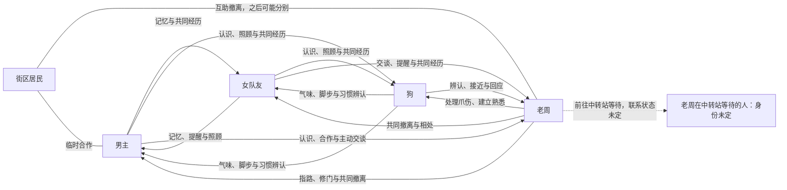
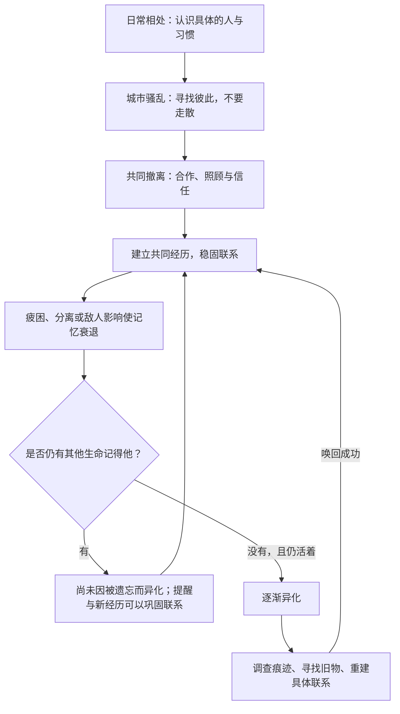

# 游戏设计文档：末世中的记忆与联系

> 死亡不是生命的结束，遗忘才是。

本项目是一款以人与人之间的联系为核心的 **3D 第三人称、单人、小队生存叙事游戏**，目标平台为电脑桌面端。正式名称尚未确定。

本文作为首版设计基准：记录已确认的世界规则、故事、人物联系和核心玩法，并将未确认事项单独列出。

当前已选择 **Unity 6、macOS 与 Windows**，并加入故事开场的 3D Demo 工程，覆盖街边日常至后巷撤离两段。画面已从灰盒升级为 URP 管线下的写实街景，并已在 Unity 6 编辑器与 macOS 构建中用自动走查完整跑通；Windows 构建尚未验证。启动方式、已实现范围、素材来源和验证限制见第 9 节。

## 1. 游戏希望带来的体验

玩家不仅要在末世活下来，还要努力记住同行的人，并让彼此继续被记得。

起初，玩家担心忘记队友会失去一个帮手；后来，玩家不愿遗忘，是因为那个人曾经和自己一起走过。

世界残酷，但整体情绪以悲伤与温情为主。照顾、等待、交谈、共同承担危险，与战斗同样重要。平凡的共同经历，可能成为将一个人唤回的关键。

创作原则：

- 先有生活，再有灾难；先产生牵挂，再解释规则。
- 联系不必都是爱，但必须指向一个具体的生命。
- 独处不等于立即被遗忘，暂时分别也不等于抛弃。
- 新的相处可以建立新的联系，关系不是只会减少的库存。
- 不将遗忘写成“不够爱”的惩罚，不将独处、丧亲或记忆障碍视为个人过错。
- 不把现实中的记忆障碍与游戏中的超自然异化等同。
- 玩法应让玩家在乎具体的生命，而不是只忙着维护数值。

美术与视觉方向：

- 采用风格化、富有诗意的表现，以柔和光线、雾气、环境色和画面留白营造孤独中仍有温度的氛围；可以借鉴《光·遇》在氛围与情绪表达上的感受，但不照搬其角色、造型、场景或具体美术设计。
- 人物必须容易辨认、各有生活质感。通过不同的身形轮廓、发型、服装配色、职业装备和动作习惯塑造记忆点；重要人物的面部与表情应足以传达关系和情绪。
- 环境与服装保留末世中的实用性和磨损痕迹，让柔和、梦幻的光影与可信的生活细节并存，不把人物处理成彼此相似的剪影。

## 2. 已确认的世界规则

### 2.1 什么能够维系一个人的存在

只要还有至少一个其他生命记得这个人，他就不会因为被所有人遗忘而开始异化。

- 爱、恨、牵挂等情感都可以构成联系。
- 单方面记得对方，也可以保护对方；不要求互相认识。
- 狗通过气味、脚步、动作和习惯认出人，与人的记忆同样有效。
- 情感构成联系的基础，共同经历不断加深联系。
- 忘记部分细节属于遗忘过程，不等于已经完全忘记这个人。
- 具体的遗忘顺序尚未确定，不预设所有人都先忘经历、再忘名字。
- 人能够察觉自己正在遗忘，但不必能准确知道已经彻底丢失的内容。

关系深厚不代表永久免疫。照片、名字、旧物、对话记录等可以作为线索，但不应仅靠持有一份名单就自动保护所有人。

**判定边界：** 本文中的“被所有人遗忘”指游戏世界内所有有效记忆联系均已断裂，不包括对现实玩家心理状态的判断。异化依据角色状态；系统不能从玩家长期未互动、未拿取道具或未选择对话，推断现实玩家已经忘记一个人。

玩家可以通过男主作出有意义的辨认，直接重建男主与目标的联系，不要求先恢复到某个记忆值门槛。玩家脑中尚未表达的记忆不自动构成游戏内保护，但也不能被系统宣布不存在。具体交互见 6.6。

### 2.2 四种存在状态

#### 活着且被记得

保持正常人的状态。疲困、分离等因素仍可能使联系逐渐减弱。

#### 活着，却被所有人遗忘

逐渐异化，从同伴变成敌人，但仍可能通过找回记忆与联系被唤回。

这一过程不是答错一次问题就瞬间完成，应当有可察觉的预兆与挽回机会。

#### 死去，但仍被记得

身体死亡，但仍保留返回的可能。归来需要：

1. 原本的身体被完好保存。
2. 通过特殊玩法，将魂魄重新引领回原本的身体。

这是“引魂归身”，不同于唤回一个仍活着的异化者。身体完好的标准、保存方式和引魂流程尚未确定。

#### 死去，又被所有人遗忘

完全失去自我，成为危险的存在：

- 交战时可以伤害玩家或其他 NPC 的生命。
- 在其附近，会加速遗忘其他人的过程。

该状态是否仍可挽回，尚未确定，不能直接视为永久不可逆。

### 2.3 睡眠、疲困与分离

- 精力越低越困，疲困会加速遗忘。
- 睡眠可以恢复精力，但不能暂停遗忘。
- 睡着不等于忘记，已有记忆仍然能够保护同伴。
- 守夜者不是靠“清醒”自动保护他人，而是靠确实记得对方。
- 分离期间，联系会随着遗忘过程衰退，不设“离队立即异化”。
- 将保留特殊的信息传递方式，让分离的人能够维系联系；具体方式尚未确定。

因此，玩家需要考虑在哪里休息、休息多久、如何安排守夜，以及休息前怎样稳固联系。睡眠中的具体衰退速度、守夜干预方式仍待设计。

睡眠和疲困造成的是角色的记忆衰退，不是对现实玩家遗忘的检测。即使角色已经无法主动回想，玩家仍能通过有意义的辨认重建联系，不受低记忆值阻挡。

## 3. 人物与联系

### 3.1 核心小队

#### 男主：玩家操控角色

已确认：男性，第三人称操控，与一名女队友和一条狗构成情感中心。

人物方向提案：习惯用解决问题来照顾别人，但不擅长表达脆弱。成长方向不是成为无所不能的保护者，而是学会接受同伴的照顾。

姓名、年龄、职业、过去，以及与女队友的具体关系未定。

#### 女队友：拥有独立意愿的同行者

她不只是男主的辅助角色。她会观察、提醒、提出路线、表达反对，也可能成为记住男主、帮助他维系自我的人。

开场暂按她与男主已经认识处理；是否亲属、朋友或其他关系未定，不预设爱情线。

#### 狗：同样能记得别人、也需要被记得的同伴

狗不是装饰，也不只是预警与寻物工具。它通过具体的习惯与经历建立关系，可以保护记得的人，也会遭遇被遗忘的危险。

它对人的辨认与人的记忆同样有效，但不能被设计为永不遗忘的保险。

名字、来历、品种、与男女主的既有关系，以及狗自己的衰退表现未定。

### 3.2 老周：开篇短暂同行者

“老周”为暂定称呼。

他是街边修理铺的修理工。骚乱发生前，仍在修东西、收拾店铺，属于这座城市尚未结束的日常。

骚乱扩散后，他凭借对街道的熟悉和修理手艺，帮助众人从后巷撤离，与核心小队暂时同行。

他准备经过服务站，再前往附近中转站等人。等待对象与具体身世未定。

识别特点：

- 会顺手修好松动的物件，嘴上可能只是说“响得烦”。
- 有一个掉漆的搪瓷杯。
- 后续替狗取出爪垫里的碎玻璃，建立具体联系。

他的作用是让玩家第一次完整理解遗忘与唤回，但他不是注定牺牲的教学道具。玩家能够让他平安同行并正常告别。

### 3.3 街区居民

修理铺附近的普通居民，在后巷撤离时与众人合作，随后各自寻找家人或去处。

他们使城市成为仍有人生活的地方，而非只供玩家搜刮的地图。不要求每个居民都成为永久队友。

## 4. 人物逻辑链条

下图中，记忆箭头 `A → B` 表示“A 记得 B，可以维系 B 的存在”，不代表双方必然互相记得。

### 4.1 核心关系图



图中包含开篇计划建立的关系，不代表这些联系在游戏第一秒就全部存在。远方人物是否记得老周尚未确定，不能忽略这一点直接安排他异化。

### 4.2 故事与机制因果链



这条链描述活人的遗忘与唤回，不代表死亡分支。生命状态与“被记得”的状态应分别记录，不合并成一条血量或记忆条。

### 4.3 关系不能凭剧情临时失效

- 一个角色只要仍被狗记得，就不能因为人类队友都忘了他而异化。
- 小队之外的人也可能维系联系，不能默认“离开玩家视野就不算”。
- 暂时分别后，联系仍可存在并逐渐衰退。
- 不能让所有人强制同时失忆，只为了播放预定剧情。
- 老周异化的剧情条件，需要在明确他的全部有效联系后才能成立。
- 未互动与未取道具不是现实玩家遗忘的证据；角色衰退与玩家主动辨认必须分别处理。
- 有意义的辨认可以改变联系和后续分支，不能在对白承认辨认后仍强制播放预定异化。

## 5. 第一章故事：还有一个人（暂名）

以下内容将已确定的开场故事与续章方向放在同一章中。5.1 与 5.2 是现有开场灰盒所依据的故事；5.3 是已整理的续章提案，尚未实现为可玩内容。人物关系、服务站情况及记忆规则仍按本文其他章节标记为未确认的部分处理。

### 5.1 第一段：还没走完的普通一天

目标时长约 0—10 分钟，属于设计估计，需通过试玩验证。

男主在街边等女队友，狗突然拉住牵引绳，不肯前进。它盯着街对面一个迟迟没有起身的人。

玩家第一次操作不是拔枪，而是停下来观察。此时无法判断，对面只是身体不适，还是发生了异常。

女队友从附近走来，叫了一声狗的名字。狗回头跑向她，紧绷的气氛暂时松开。

她带回一些饮水，玩家可以接过东西，找一个不挡路的位置给狗喝水。她顺口提醒：

> “碗放稳一点，它怕那个响。”

狗的实际行为应体现这一习惯，而不是只留下一句日后考试的台词。不互动不会立即受到惩罚。

一行人经过修理铺。老周正在搬一把松动的椅子，狗凑过去闻，他先放下工具，再让狗靠近。

远处传来撞击声。他抬头看了一眼，又低头检查椅脚：

> “这两天怎么老出事。”

店里仍有未取走的物件，水杯放在工作台边。镜头不刻意标记“这是重要道具”。

随后，城市开始无法按原来的方式运转：路口车辆不动，有人逆着人流往回跑，商店开始提前关门。

一次冲撞让女队友和狗短暂离开男主视线。当前目标变成“找到他们”。玩家根据呼喊、叫声和外观重新找到同伴。

重聚后，女队友先确认男主有没有受伤，再说：

> “先离开这儿。”

原路已不适合通行。老周从修理铺侧门探出身：

> “别挤前面，后头能走。”

玩家跟随进入后巷。此时尚不解释遗忘规则。

### 5.2 第二段：穿过后巷

目标时长约 10—20 分钟，同样为待验证估计。

老周带核心小队与几名居民进入后巷。侧门关上，街上的喧闹变得沉闷，巷子里仍有空调外机、楼上争吵和未关闭的电视声。

巷尾铁门被一条锈死的链子锁着，轨道变形，门前从左墙到右墙堆满了多年的杂物，没有任何可以绕过去的缝隙。众人自然分工：

- 男主搬开较重的障碍。
- 街坊和老周清走一个人拿得动的东西，老周随后处理链子和卡住的轨道。
- 女队友留意后方、照看狗。
- 居民扶住门，让众人通过。

女队友注意到男主的手：

> “等一下，手往外一点，别夹住。”

这段强调同伴也会照顾男主，而非所有人都等待玩家保护。

杂物搬到一半，巷口出现一个人。他只是站着，对呼喊没有正常回应。铁门尚未打开，他开始往里走，身后陆续跟进更多同样状态的人，攻击靠近的居民，也去拽正在开门的老周。此时不确定他们的具体存在状态，不直接宣布为丧尸或被遗忘者。

来路已经被堵死，身后只有这道门。玩家目标是“挡住对方，让老周把门打开，然后撤离”，不要求击杀。可以推开、阻挡；女队友和能动手的街坊也会一起挡，吓坏的人只能缩在墙根。有人缠住老周时，门上的活就停下来。

众人撤到另一侧，把挤在门口的人顶出去，关住铁门，确认同行者有没有跟上。门外的人还在拍门。

准备离开时，一位居民问：

> “刚才修理铺门口，是不是还有个人？”

不同的人给出不一致的回答。玩家可以回头观察，但无法确认。

这只是异常线索，不证明有人已经异化；若仍有人确切记得一个人，他就不能被当作“已被所有人遗忘”。

老周说：

> “先到前面开阔的地方。别堵在这儿。”

离开后巷后，居民各自寻找家人或去处。老周准备往服务站方向走，不承诺那里安全，只说至少有能遮雨的地方。

男主与女队友商量后，决定与他同行。信任来自刚刚的合作，而非任务栏强制指定。

### 5.3 第三段：找个能避雨的地方（暂名）

这一段承接后巷撤离。众人刚刚一起脱险，但彼此还不算熟悉；故事通过同行、等待和照顾，逐步建立信任。以下为可供后续制作的场景脚本初稿：对白、交互和场景顺序可以在试玩后调整，不代表角色背景或世界规则已经全部定案。具体路线、场景大小与时长尚待验证。

本段的体验目标是从“刚刚一起逃出来”走到“愿意暂时继续同行”。不以战斗胜负、收集率、关系数值或是否捡到某个物件决定剧情资格。

#### 后巷出口：确认彼此都在

**场景起点：** 铁门合上，众人来到较开阔处。街上的声音被隔远，短暂安静下来。居民互相确认后，各自去寻找家人或落脚处。

**玩家行动：** 玩家可以在众人之间走动，靠近女队友、狗或老周。若暂时没有互动，角色会用简短动作和对白互相确认，不让流程卡死在漏掉某个对象上。

女队友看向男主，确认他没有受伤：

> 女队友：“先缓一下。我们都出来了。”

老周望向前方，指明一个可以暂时避雨的方向：

> 老周：“服务站那边有屋檐。先过去看看，至少不用站在路中间。”

若玩家询问是否安全：

> 老周：“不知道。能遮雨，不等于安全。”

**场景收束：** 男主与女队友商量后决定暂时同行。是否回望后巷是玩家自由行为；居民的疑问继续保持不确定，不触发强制搜寻，也不据此宣布任何人已被遗忘或异化。

#### 路上遇阻：一起找路

**场景目的：** 让每位同行者自然参与，而不是把所有人变成等待玩家指挥的任务目标。

前往服务站的途中，原定路线被杂物或封锁挡住。玩家可以协助挪开一件轻便障碍，也可以跟着老周走一条能汇回原路线的窄道。两种走法都不设失败惩罚，不把队友留在无法返回的岔路。

- 老周凭借对街道的熟悉判断路线。
- 女队友观察周围，并留意队伍后方。
- 狗对陌生气味或声音作出反应。
- 男主协助处理阻挡或带领大家通过。

**对白提案：**

> 老周：“这边还能走，别挤到门边。”
>
> 女队友：“我看着后面，你先过去。”

若玩家挪开障碍，老周扶稳另一侧：

> 老周：“慢点，别硬抬。让出一条缝就够了。”

若玩家选择绕行：

> 女队友：“我先过去看一眼。你们跟着老周，别走散。”

狗在路线另一端停下来，回头等其他人，而不是用一次叫声把玩家引向唯一正确答案。障碍只承担同行节奏与空间协作，不设计成战斗考试或限时失败。

#### 短暂停下：发现狗受伤

通过障碍后，狗开始走慢，抬起一只爪。众人停在不挡路的位置，发现它的爪垫里扎了碎玻璃。

**玩家行动：** 玩家可以靠近并蹲下，让狗先闻手；也可以先观察，让女队友安抚它、老周准备处理伤口。事件不设倒计时，也不因玩家稍作停留或没有立即选择互动而额外恶化。关键动作可由同伴自然接续，确保剧情不被可选操作卡住。

**对白提案：**

> 女队友：“别急，让它先闻闻你的手。”
>
> 老周：“我看看。碎玻璃，先别踩地。”

男主稳住狗后，老周取出碎片并简单包扎。不要把伤情写成重伤，也不要加入尚未决定的治疗系统。处理结束后：

> 女队友：“好了。我们陪它慢慢走。”
>
> 老周：“不赶这几步。”

这段通过动作表现照料，不弹出关系数值，不考玩家记住先前台词，也不把选择互动与否当作角色是否记得狗的证据。

#### 临时休息：聊一点，不讲完所有故事

众人找到一个暂时可以避雨的地方（具体地点与环境尚待场景设计），稍作停留，整理随身物品。狗休息；女队友观察外面；老周擦去搪瓷杯上的水迹。

玩家可以选择以下任意互动，也可以什么都不做，等待其他人准备好：

- **询问搪瓷杯：** 老周看了一眼杯沿。

  > 老周：“修理铺里一直用着，顺手就带出来了。”

  这只说明杯子与他的日常有关，不揭示尚未确定的身世或等待对象。

- **看看狗的包扎：** 女队友让狗保持舒服的姿势，老周确认它暂时可以慢慢走。

  > 女队友：“它愿意靠过来了。让它歇一会儿。”

- **询问接下来去哪：** 老周说明自己之后还要去附近中转站等人，但不必说出等待对象是谁。

  > 老周：“我还得去趟中转站。等雨小点，再看哪条路好走。”

- **安静休息或查看路线：** 不触发额外对白也不受到惩罚。

物件观察、额外交谈和休息选择都是补充表达，不是进入下一段的钥匙。若未来加入精力或疲惫表现，须依照已确认的机制另行设计；本段不为展示机制强迫失忆、扣除关系或让角色认不出同伴。

#### 抵达服务站：暂时落脚

队伍抵达服务站外围。先从可见环境判断是否能靠近；不预设服务站已经安全、有人驻守或一定开放。老周停下，给大家留出选择和观察的时间：

> 老周：“先看看里面有没有地方能歇脚。要是不合适，我们再找别处。”
>
> 女队友：“这次慢一点，先听听里面有没有动静。”

**玩家行动：** 玩家可以查看入口与周围，再与两名同伴交谈。目标是确认暂时落脚的可能，而不是宣布服务站安全。

**本段结尾：** 队伍停在服务站入口附近，商量先观察、再决定是否进去。老周保留前往中转站等人的个人打算；男主和女队友只承诺暂时同行。等待对象的身份与关系不揭晓。以一段安静的共同准备收尾，为后续章节留下去留和路线空间。

### 5.4 后续剧情方向（待确认）

以下想法尚未定为第一章内容；在后续设计中，应继续遵守本设计文档关于有效记忆联系、主动辨认与可选物件的规则。

- 可能出现较短但危险、较长但消耗精力的路线抉择；两条路线都应让玩家有机会认识老周。
- 狗可能发现老周遗落的杯子，玩家可以捡回并形成新的共同经历；漏捡不能直接判定失去联系。
- 服务站之后可以根据联系状态发展不同分支：联系稳定时允许老周平安过夜并正常告别；联系变弱时由仍记得他的同伴提供提醒；只有在所有有效联系确实断裂且符合世界规则时，才考虑老周逐渐异化及寻找、唤回的剧情。
- 任何异化分支都不能仅因没有捡杯子、没有额外交谈或现实玩家长期未操作而触发。需要提供不依赖单一可漏捡道具的辨认路径。
- 唤回互动提案：玩家把松动的椅子推到老周附近，他下意识扶住椅脚；玩家通过熟悉动作确认身份，建立重新接近的入口。该动作应真实改变联系与回应，不等于一键治愈或完成全部恢复。

## 6. 核心玩法

### 6.1 旅途循环

**寻找下一个落脚点 → 探索与合作 → 战斗或绕行 → 消耗资源与精力 → 判断联系风险 → 休息、照顾与相处 → 再次出发。**

连续旅途是主体，没有永久安全的家。地图规模未定，不预设庞大开放世界。

### 6.2 生存与战斗

已确认：

- 战斗比重适中，可以正面对抗，但弹药和体力有限。
- 潜行、绕行、阻挡、撤退都应有实际价值。
- 敌人不仅威胁生命，也可能侵蚀记忆联系。

待原型验证的基础数值划分：

- **生命值：** 身体受伤与死亡。
- **体力：** 奔跑、闪避、近战的短期消耗。
- **精力：** 长时间行动后的疲困，主要通过睡眠恢复。
- **定向记忆状态：** “谁记得谁”，不能用单一的小队总记忆条代替。

具体范围、衰退速度、恢复量和界面表现均未定。

### 6.3 记住同伴

- 通过对话了解名字、过去、心愿与习惯。
- 通过共同探索、战斗、照顾和选择积累经历。
- 在关键时刻回答问题、辨认对方，或用行动重现关系。
- 不频繁弹出考试，不依靠刁钻细节和从未展示的信息制造失败。
- 重要答案必须有公平获知的机会。
- 普通相处能够维系关系，不要求反复刷礼物或制造生死事件。
- 有意义的辨认无需先满足记忆值门槛；不能一边允许玩家正确认出对方，一边以角色记忆不足为由拒绝承认联系。

狗的互动不完全照搬人类答题。熟悉的手势、口令、安抚行为和共同习惯可作为设计方向，具体规则待定。

### 6.4 休息与联系维护

玩家需要权衡精力恢复和记忆衰退。睡眠不是安全暂停，也不能变成无论如何安排都只能失败。

候选行动包括睡眠、守夜、治疗、整理装备、交谈与照顾狗。每个行动的时间成本和效果待验证，不预设成僵硬的每日多选一菜单。

### 6.5 找回与归来

必须区分两种玩法：

- **活人异化后的唤回：** 找到痕迹、重建联系、确认身份。
- **死者的引魂归身：** 保存原身、寻找方法、完成引领过程。

二者都不能仅靠点击旧物自动完成。死去又被遗忘者的处理方式仍未确定。

### 6.6 玩家知识与角色记忆

已确认采用“角色规则优先”：异化由游戏内的记忆联系决定，不以程序猜测现实玩家是否忘记为依据。

需要明确区分：

- **现实玩家的记忆：** 系统不能直接读取，也不能因长期没有操作就判为不存在。
- **角色的记忆：** 会受疲困、睡眠、分离等因素影响，可在游戏规则中模拟。
- **玩家作出的辨认：** 玩家通过男主，把具体的人与名字、物件、行为或共同经历联系起来；系统能够识别这种行动，并据此重建角色联系。

调查、呼唤和寻找旧物是入口，不是每次点击都自动认出所有人。完成有意义的辨认时，必须立即承认联系已经建立，不能提示“记忆值不足，无法辨认”，也不能要求先刷交谈或补满数值。

重建联系不等于立即治好身体、消除异化的全部后果或完成引魂归身。联系效果与身体恢复分开处理；后续恢复步骤不能再以“你仍未记得他”为由撤销已经发生的辨认。死去又被所有人遗忘者是否能恢复自我，仍按未定规则处理，不在此默认可以唤回。

反过来，玩家没有拿杯子，可能是因为携带限制；没有回头，可能是认为老周已经安全。这些行为不能单独等同于遗忘，也不额外作为“忘记惩罚”扣除联系。角色仍可按既定疲困、睡眠和分离规则衰退，两者不能混为一谈。

当角色认不出某人时，反馈可以是“男主想不起这个人是谁”，不能是“你已经忘记了他”。只要玩家有意义地辨认，剧情分支就应响应；接受有些玩家始终维系住老周，因此永远不触发他的异化。

不通过禁止现实记笔记制造难度。游戏内是否提供日志、对话回看，以及记录能怎样影响角色记忆，尚待设计。

叙事表现提案：老周离队很久以后，在另一处放置一把松动的椅子，不强制弹出回忆或“想起老周”选项。玩家可能自行停下、想起他。这类回响不必全部转化为计分项，与可判定的辨认交互并存。

## 7. 第一阶段构建范围

先构建一段能够验证核心体验的灰盒切片，不立即制作完整城市或全部复活系统。

建议范围：

1. 一段街边日常空间、修理铺和相连后巷。
2. 一个可操控男主、女队友、狗、老周，以及少量居民。
3. 第三人称移动、镜头、基础交互与同伴跟随。
4. 给狗饮水、遇见老周、铁门合作等关系场景。
5. 一场以掩护撤离为目标的基础防御遭遇。
6. 一个独立可测试的记忆规则样本，验证定向联系、睡眠与遗忘判定。

开场不为了展示机制强制安排异化。规则样本可以先作为开发验证场景，之后再接入服务站章节。

暂不纳入第一阶段：

- 大型开放世界、复杂制作与基地建设。
- 大量武器和敌人种类。
- 全量人物剧情、完整引魂流程、最终结局。

### 7.1 必须验证的结果

- 任何一个有效的其他生命仍记得目标时，目标不能因“所有人遗忘”而异化。
- 单向联系有效，狗的辨认有效，睡眠中的记忆有效。
- 部分记忆模糊不直接等于完全遗忘。
- 精力与睡眠的效果遵守规则，不靠剧情临时覆盖。
- 男主记忆处于最低状态时，玩家仍能通过有效辨认直接重建联系，不需要先恢复数值。
- 辨认后联系与分支真实改变；老周开始异化时，辨认能成为接近与唤回的入口，不必立即完成身体恢复。
- 未捡杯子、未选对话不单独触发额外遗忘惩罚；反馈不将角色状态说成现实玩家的心理状态。
- 玩家持续维系有效联系时，可完成老周平安告别分支，不强制补异化剧情。
- 同伴跟随与合作不能阻塞关键通路。
- 玩家不击杀任何一名异常者，也能完成撤离。
- 不强制死亡、失忆或异化以播放预定剧情。
- 联系、生命状态和分支进度在后续接入存档时应完整保留。

## 8. 开工前与后续待确认事项

优先影响构建的决定：

1. **游戏引擎与目标系统已确定：** Unity 6，目标为 macOS 与 Windows；需安装对应平台构建模块。
2. **美术与制作规模：** Demo 目前用写实方向做了一版画面验证（扫描材质、开源人物与动捕，见 9.6），人物、狗和道具均为占位资产；正式采用写实、风格化或低多边形，以及是否自制角色，仍待确认。
3. **输入方式：** 键鼠优先，还是同时要求手柄。

需要继续完善的世界规则：

- 记得他人的人死亡后，其记忆是否仍能保护别人。
- “仍记得一个具体的人”的最低判定、衰退和重新建立联系的条件。
- 有意义辨认的具体交互、反馈与效果；需遵守不设记忆值门槛、不依赖唯一道具的已确认边界。
- 多段联系如何影响稳定程度，而不将人数直接等同于无敌。
- 睡眠、守夜、分离和信息传递的具体机制。
- 遗忘的表现顺序，以及人与狗的区别。
- 原身保存标准、引魂过程、失败代价与归来条件。
- 死去又被所有人遗忘者是否还能被挽回。
- 老周在小队外的有效联系，尤其是他等待的人。

需要继续完善的故事与体验：

- 男女主和狗的姓名、关系、背景与各自目标。
- 小队长期前进的目的地与动机。
- 日志、对话回看、存读档与难度设计。
- 遗忘现象的最终原因和揭示节奏。

这些内容在确认前不视为既定设定，不通过程序默认值或强制剧情替代创作决定。

## 9. 开场 Demo 工程

### 9.1 如何启动

1. 安装 Unity Hub，以及 **Unity 6000.6.7f1**（工程当前版本，见 `ProjectSettings/ProjectVersion.txt`）。建议使用相同版本；用更旧的编辑器打开会被拒绝或降级资源。
2. 在 Unity Hub 中添加磁盘上的项目。若文件选择框提示选择“包含 Unity 项目的文件夹”（或出现 `No projects found. Select a folder that contains Unity projects.`），请选择项目的**上一级文件夹**，让 Hub 扫描出其中的 `Dont forget me`，再选中该项目添加。不要在这种扫描入口中选择项目本身或 `Assets/Scenes`。若 Hub 提供直接添加单个项目的入口，则选择本 README 所在的项目根目录。
3. 工程使用 **Universal Render Pipeline（URP 17.6，Forward+）**，管线资产在 `Assets/Settings`，已随工程提交，无需另建模板或手动转换。首次打开会导入约 385 MB 的美术素材并编译着色器，需要几分钟。
4. 在顶部菜单选择 **Dont Forget Me → Open Opening Scene**，再按编辑器的 Play。
5. 在 Game 窗口点击“开始这段旅程”。推荐窗口比例为 16:10 或 16:9。

场景文件为 [Opening.unity](./Assets/Scenes/Opening.unity)。场景内只保留入口对象，街道、角色、灯光、镜头和 UI 会在进入 Play 后由代码生成，因此编辑模式下看起来是空场景。

界面字体随工程内置（思源黑体 / 思源宋体的简体子集），不再依赖系统字体，macOS 与 Windows 显示一致。

如果增删或替换了 `Assets/Art` 下的素材，执行 **Dont Forget Me → Rebuild Art Library**，重新生成材质、预制体和运行时使用的素材目录（`Assets/Art/Generated` 与 `Assets/Resources/DFM/ArtCatalog.asset`）。只改代码不需要执行。

### 9.2 操作与流程

- **W / A / S / D：** 移动。
- **鼠标：** 第三人称视角。
- **左 Shift：** 奔跑，消耗体力。
- **E：** 执行附近显示的互动。
- **F：** 上前一步，双手把面前够得着的人推开。只对正前方约 1.7 米内的人有效，推出去的人会踉跄后退、撞到身后的人；消耗体力并有短暂冷却，连续推会把体力用空。不是必杀攻击。
- **Esc：** 暂停、释放鼠标，可继续、重开或退出。暂停菜单不是故事中的睡眠。

当前流程为压缩的切片，不代表最终章节的 20 分钟节奏：

1. 出生在街边，可先给狗倒水，也可直接去修理铺。
2. 老周在铺子门口的工作台前干活，与他交谈。旁边的五金杂货店开着门，两位街坊正在店里店外挑东西、和店主说话。椅子与搪瓷杯有额外观察内容，不捡取或不观察不会受到遗忘惩罚。
3. 骚乱发生：所有人都被响声惊到，杂货店拉下卷帘门，一位街坊抱头缩在原地，另一位跑到路中间张望。女队友和狗往路口移动，跟随提示找到她们，靠近女队友按 E 会合。
4. 跟随老周进入街道尽头的后巷。巷尾的铁门被链子锁死，门前从墙到墙堆满杂物。
5. 搬杂物：靠近后按 E。主角会走过去、弯腰抓住、搬到墙边放下，手一直在东西上；最后一件是卡在轨道上的手推车，要扳倒了拉走。共 4 件重物由玩家搬，前面挡着的轻东西由街坊和老周清理，玩家也可以代劳。搬到一半，巷口会出现第一个站着不动的人。
6. 到门边与老周互动，他开始砸链子、校正轨道，约需 42 秒的实际工作时间。异常者从巷口分批进来，最多 9 人：他们会举起手臂逼近、后仰蓄力再扑上来，扑中会扣生命并把人撞退。能动手的街坊和女队友会各守一个位置把人推回去，另一位街坊缩在门柱边；人一多，多出来的会绕过去拽老周，**老周被缠住时进度条停住**，要把他身边的人推开才能继续。
7. 门开后所有人冲过去，街坊守在门口。此时异常者只扑向还在门外的人和站在门口的人，不会追进院子深处，所以主角过门后继续往里走、离开门口就安全了。人到齐后，街坊先把挤在门口的人推出去，再把门推上。门外的人继续拍门。去老周身边确认所有成员都在，结束这段开场。

体力停止奔跑后恢复；生命耗尽可以重开。精力在此版缓慢消耗（静止/步行 0.025 点/秒、奔跑 0.08 点/秒），但尚未接入疲困导致的记忆衰退，避免在没有完整预警与挽回交互前加入惩罚。

### 9.3 当前实现与未实现

已实现：

- 老街、修理铺、后巷、铁门和院子。可行走范围与碰撞沿用最初灰盒的布局；建筑立面、店铺内景、招牌、窗户、空调、电线、晾晒衣物和道具摆放由代码按固定随机种子生成，每次运行结果相同。
- URP 画面：HDR 天空与环境光、四级级联软阴影、带阴影的局部灯光、屏幕空间环境光遮蔽、反射探针、积水与污渍、ACES 色调映射、泛光、暗角、胶片颗粒、时间性抗锯齿；紧张段落会整体转冷、降饱和。菜单打开时背景景深虚化。
- 带骨骼的人物与动作捕捉动画（站立、行走、奔跑、交谈、紧张、干活、蹲下），按移动速度混合；人物会转头看向相关的人。狗的步态、摇尾、耳朵和喝水为程序生成。
- 动作捕捉之上的一层肢体动作：脊柱前倾后仰，双手通过手臂反向运动学放到世界中的具体位置。推人时手掌落在对方胸口、被推的人上身后仰双臂甩开并倒退着踉跄、扑击前后仰蓄力、搬东西时双手扶在箱子两侧、抱头蹲下、拍打铁门，都由这一层生成。素材库里没有这些动作的捕捉片段，所以它们是程序姿态而不是动捕，细看会比走路僵硬。
- 第三人称移动与镜头：加减速、镜头防穿墙、奔跑时视野变化、受击震动。
- 人与人之间不再互相穿过：每个人会把自己从别人身上挤开，轻的让得多；走路时会从挡在前面的人身边绕过去。
- 女队友、狗、老周和两名街坊在每个阶段都有事做：街坊开场是杂货店的顾客，骚乱时一个抱头一个张望；进巷后街坊和老周清理轻杂物，女队友带狗盯着来路；围堵时一个街坊上前推人、女队友守在老周侧后、另一个街坊缩在门柱边、老周开门；最后由动手的街坊守门、关门。
- 异常者：共四种外形、最多 9 人，从巷口两侧拐进来。各自选择目标（每个同伴身上最多一两个，多出来的去找老周），被谁推了会记仇几秒；逼近、蓄力、扑击、被推后踉跄、撞墙后跪倒再爬起，门关上后挤到门前拍门。巷口一侧的两盏灯会随着人数增加依次熄灭：各抖两下后灭掉或变暗，不会持续闪烁。
- 局部灯光的阴影有固定预算：阴影图集放得下 16 张 512 的阴影图，点光源占 6 张、聚光灯占 1 张，目前修理铺的灯管、杂物堆上方的巷灯和门口的聚光灯共用 13 张。超出预算时 URP 会按镜头里看得见的灯逐帧重新缩放所有阴影，墙上的影子会跳，所以新增带阴影的局部灯之前要先算这笔账。
- 铁门：下半截铁皮、上半截栏杆的推拉门，带滚轮、变形的地轨、门闩、链子和挂锁；门前是固定的两侧杂物堆和 10 件可以搬走的杂物。
- 五金杂货店：敞开的店面，货架上逐层摆货，门口堆着盆、桶、塑料椅，有柜台和店主，骚乱时拉下卷帘门。
- 距离与遮挡检测的互动提示、带说话人标注的中文对白、目标引导、章节标题、暂停、重开和结束画面。界面按分辨率缩放并保持文字清晰。
- 可跳过的给狗倒水、椅子与杯子观察。
- 搬杂物、可被打断的开门进度、非致命推开、全员通过后关门收尾。
- 定向记忆核心模型：单向联系、其他观察者保护、部分衰退、有效辨认直接重建联系。

尚未实现，不在此版伪装成完整功能：

- Sandbox 测试场和开场之后的第二章（打电话、狗的爪伤、过夜、道别）。它们在灰盒版本那条开发线上实现过，但按的是画面升级前的接口，放进现在的工程无法编译。相关脚本原样存放在 [Assets/Parked~](./Assets/Parked~/README.md)（Unity 不编译这个文件夹），等移植到新接口后再搬回；`Assets/Scripts/Core` 里对应的纯规则代码和测试不受影响，仍在编译和测试范围内。
- 完整记忆衰退、睡眠守夜、异化与唤回的可玩流程。
- 服务站章节、狗的爪伤场景、引魂归身。
- 正式角色美术。人物是开源研究用虚拟人（见 9.6），精度约为上一代主机水平，没有表情与口型；狗暂用比格犬模型，**不代表品种已确定**。
- 配音和正式音效。环境声、脚步、狗叫、提示音，以及推撞、拍门、低吼和锤击声，均为程序合成的占位音，不是录音。
- 全局光照烘焙。场景在运行时生成，间接光来自天空环境光与环境光遮蔽，没有光照贴图。
- NPC 自动寻路。同伴和异常者使用固定路线、朝目标直走、互相挤开和绕人，没有导航网格；在目前这条直巷里够用，换成复杂地形会卡住。
- 倒地、扭打、抓住不放等需要专门动捕的近身动作；异常者没有受伤或死亡状态。
- 存档、键位重映射与手柄支持。
- Windows 构建验证，以及 macOS 的签名与公证。

记忆核心已经由开场相识与重聚事件建立联系，但不会在本章强行扣到零来展示异化。核心模型仅模拟活人的记忆联系，不擅自实现仍未确定的死亡后联系规则。

### 9.4 导出 macOS 与 Windows

先通过 Unity Hub 为编辑器安装目标平台的 Build Support 模块，再使用：

- **Dont Forget Me → Build → macOS**：输出 `Builds/macOS/DontForgetMe.app`。
- **Dont Forget Me → Build → Windows x64**：输出 `Builds/Windows/DontForgetMe.exe` 及其依赖目录。

当前构建菜单采用 Mono 后端。Windows 需要相应的 Windows Build Support（Mono）模块。缺少平台模块或构建失败时，菜单会明确报错，不会宣告成功。

不能只复制 Windows 的 exe；分发时需要保留同目录的全部构建文件。macOS 构建约 630 MB。

构建在超过约 1080p 像素量的屏幕上会自动降低内部渲染分辨率并用 FSR 放大，界面文字仍按原生分辨率绘制。

### 9.5 验证方式与当前结果

**自动走查。** `DemoAutopilot` 会在无人操作的情况下把整个开场走一遍：倒水、交谈、会合、进巷、等街坊清开前排后依次搬走 4 件重物、帮老周顶住、推开异常者、过门、等门关上、收尾，再点“重新开始”确认能回到标题画面；每个节点保存一张截图，任何一步超时都会记为问题并写入日志。围堵进行到一半时，它会故意退到一边站十来秒，用来检验没人掩护时老周会不会被缠住、缠住后门还能不能开。

走查同时做三项针对画面和收尾的检查，任何一项不过都记为问题：

- **阴影预算。** 监听引擎日志，出现“局部灯光阴影被缩小以塞进图集”的提示即为问题。
- **场景是否闪烁。** 在街道、杂货店、巷口、巷内两侧墙和院子两侧墙共 7 个静止视角，隐藏人物与界面，连续取 8 帧，把画面分成 32×20 个区块比较亮度；任何区块变化超过满亮度的 10% 即为问题，并把首尾两帧存为 `unsteady_*.png`。这项只在有真实显示的构建程序里执行：无显示器时截图走的是离屏渲染，那条路径本身逐帧不稳定，比较没有意义，会在日志里注明已跳过。它只覆盖这 7 个视角、镜头静止时的场景，不覆盖镜头移动中和围堵过程中的画面。
- **门关上后门内不能留有异常者。**

- 编辑器内：**Dont Forget Me → Validate → Run Scripted Walkthrough**，截图和日志写到 `Logs/Walkthrough`。
- 构建后：用 `-dfmAutopilot -dfmShots <输出目录>` 启动程序。有问题时进程以非零状态退出。

没有显示器的批处理运行（`-batchmode`）会按固定每秒 45 帧步进游戏，因此不报告帧率；帧率只在构建出的程序里测量。

本机（Apple M1，Unity 6000.6.7f1 的 macOS 构建，1600×1000 窗口）最近一次走查结果：全流程 0 个问题；平均约 55 帧/秒，最慢一帧 167 毫秒。那一次围堵中巷子里共有 9 名异常者，开门工作在 70% 处被打断过一次后恢复，脚本落下 24 次推击，结束时生命 28 / 100。7 个静止视角里变化最大的区块为满亮度的 0.4%–1.9%，日志中没有阴影被缩小的提示。同屏人物从 7 个增加到最多 15 个，帧率比上一版的约 58 帧/秒有所下降；2560×1600 全屏在这一版**没有重新测量**。这是单台机器、单次运行的数字，围堵里有随机成分，每次结果会不同：修正过门规则之后连续 7 轮（4 轮构建程序、3 轮无显示器；其中升级到 6000.6.7f1 之后各 1 轮）都是 0 个问题，结束时生命在 28–91 之间。

走查脚本的反应比人快，它能通过不代表难度对真人合适：数值是靠它和几轮调整定下来的，没有经过真人试玩。

**规则测试。** 纯 C# 测试不需要 Unity。安装 .NET 8 SDK 后，在项目根目录执行：

```sh
dotnet test Validation/CoreTests.csproj
```

共 63 项，合并两条开发线之后已执行并全部通过：开场与记忆规则 35 项（含参数化用例），Sandbox 装备与遗忘规则 28 项。Sandbox 的这部分只覆盖纯规则代码，它的场景脚本目前没有编译（见 9.3）。覆盖剧情阶段不能越级、不喂水不击杀也能完成、默认两件杂物与 14 秒的阈值、可配置的杂物数量与开门时长（Demo 使用 4 件、42 秒）、全员到场条件、单向联系与其他观察者的保护作用、部分衰退仍然有效、辨认可直接恢复联系、查询与未互动不额外扣除记忆、非法参数明确报错。

仍未验证：Windows 构建与运行（本机未安装 Windows Build Support）、手柄、除 Apple M1 以外的硬件，以及真人试玩下的难度、同伴站位和人群挤压时的边界情况。

### 9.6 第三方素材与许可

| 内容 | 来源 | 许可 |
| --- | --- | --- |
| 人物模型、狗模型、动作捕捉动画（`Assets/Art/Characters`、`Assets/Art/Animations`）。异常者和杂货店店主使用同一素材库里另外四个成人模型 | [Microsoft Rocketbox Avatar Library](https://github.com/microsoft/Microsoft-Rocketbox) | MIT |
| 道具模型、地面与墙面材质、天空 HDR（`Assets/Art/Props`、`Surfaces`、`Sky`） | [Poly Haven](https://polyhaven.com) | CC0 |
| 界面与招牌字体（`Assets/Art/Fonts`） | [Noto CJK](https://github.com/notofonts/noto-cjk) 简体子集 | SIL OFL 1.1，许可全文见 [OFL.txt](./Assets/Art/Fonts/OFL.txt) |

为控制体积，贴图已从原始 TGA 转为 JPG / PNG，金属度、粗糙度与遮蔽合并为一张贴图；天空图旋转了方位并压低了太阳峰值亮度，使其与场景中的方向光一致。

`Assets/Art` 约 385 MB，全部是二进制文件。提交到 Git 前建议启用 Git LFS，否则仓库体积会迅速增长。
